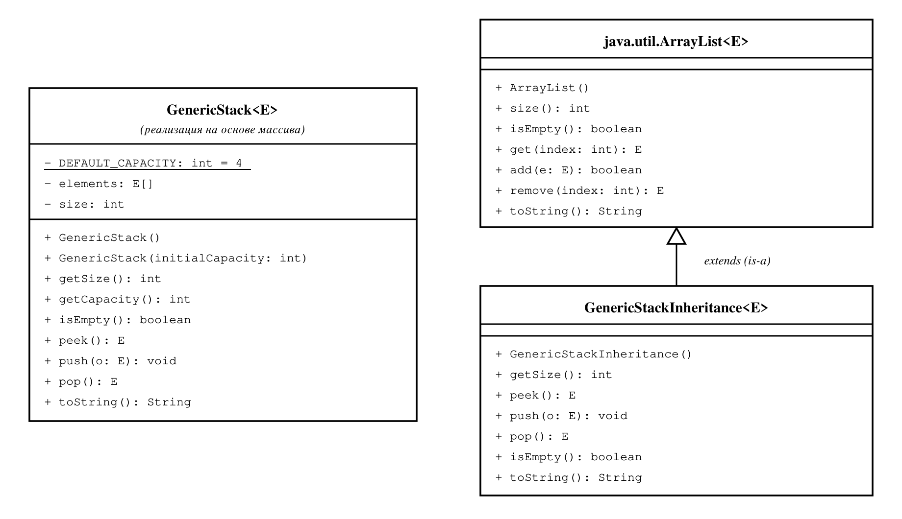
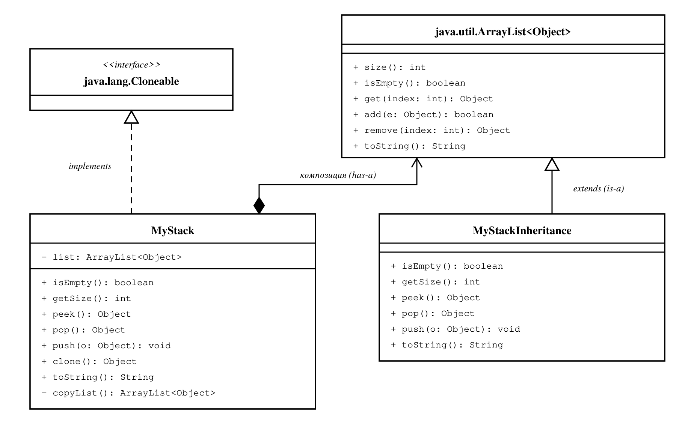

::: {custom-style="StructuralHeading"}
ВВЕДЕНИЕ
:::

Настоящий отчёт посвящён выполнению практической работы № 5 по дисциплине «Программирование на языке Java» на тему «Дженерики и обобщённое программирование. Структуры данных. Стек».

Целью работы является изучение обобщённых (параметризованных) классов и методов языка Java, способов реализации абстрактной структуры данных «стек» с помощью массива, композиции и наследования, а также механизма поверхностного и глубокого клонирования объектов с использованием интерфейса `Cloneable`.

Для достижения поставленной цели решаются следующие задачи:

- реализовать обобщённые методы удаления дубликатов из `ArrayList`, линейного поиска в массиве и поиска наибольшего элемента в одномерном и двумерном массивах с использованием `Comparable`;
- реализовать обобщённый стек `GenericStack<E>` на основе динамически расширяемого массива, а также класс `GenericStackInheritance<E>`, наследующийся от `ArrayList<E>`, и построить их UML-диаграмму;
- разработать класс `MyStack` на основе композиции и класс `MyStackInheritance` на основе наследования от `ArrayList<Object>`, построить их UML-диаграмму и реализовать клиентскую программу вывода пяти строк в обратном порядке;
- реализовать глубокое копирование поля списка в классе `MyStack` путём переопределения метода `clone()`.

# 1 Теоретические сведения

## 1.1 Обобщённое программирование (дженерики)

Дженерики (`generics`), введённые начиная с JDK 1.5, позволяют параметризовать классы, интерфейсы и методы формальными параметрами типа (обычно обозначаемыми заглавными буквами `E` или `T`). При обобщённом инстанцировании формальный тип заменяется конкретным ссылочным типом, благодаря чему компилятор проверяет совместимость типов на этапе компиляции и исключает ошибки приведения во время выполнения. Ограничение вида `<E extends Comparable<E>>` гарантирует наличие у элементов метода `compareTo(E o)` для их упорядочивания.

## 1.2 Структура данных стек и клонирование объектов

Стек представляет собой структуру данных, работающую по принципу LIFO (`Last In, First Out` — «последним пришёл — первым обслужен»). Добавление элемента на вершину выполняется операцией `push`, чтение вершины без удаления — операцией `peek`, извлечение с удалением — операцией `pop`. Стек может проектироваться с помощью отношения композиции (`has-a`, список или массив хранится в закрытом поле класса) либо отношения наследования (`is-a`, класс расширяет `ArrayList`). Композиция предпочтительнее, поскольку скрывает от клиента методы произвольного доступа к элементам списка.

Для клонирования объектов в Java используется маркерный интерфейс `java.lang.Cloneable` и переопределение защищённого метода `Object.clone()` с расширением модификатора доступа до `public`. Сравнение поверхностного и глубокого копирования приведено в таблице 1.

Table: Таблица 1 — Сравнение поверхностного и глубокого клонирования объектов

| Характеристика | Поверхностная копия | Глубокая копия |
|---|---|---|
| Способ получения | Вызов `super.clone()` без копирования ссылочных полей | Вызов `super.clone()` с созданием копий изменяемых полей |
| Примитивные поля | Значения копируются независимо | Значения копируются независимо |
| Ссылочные поля | Копируется только ссылка на общий объект | Создаётся новый независимый объект |
| Изменение списка в копии | Отражается на исходном объекте | Не влияет на исходный объект |

# 2 Постановка задачи и структура проекта

Исходный код практической работы разделён на три пакета: `generics` (обобщённые алгоритмы и классы `GenericStack`), `mystack` (классы `MyStack` и клонирование) и `app` (тестовые программы). Графические UML-диаграммы размещены в каталоге `images`. Структура проекта приведена в таблице 2.

Table: Таблица 2 — Структура проекта практической работы № 5

| Файл | Пакет / каталог | Назначение |
|---|---|---|
| `generics/Circle.java` | `generics` | Класс круга с полем `radius`, реализующий `Comparable<Circle>` |
| `generics/GenericUtils.java` | `generics` | Четыре обобщённых метода задания 1 части 1 |
| `generics/GenericStack.java` | `generics` | Стек `GenericStack<E>` на массиве с удвоением ёмкости |
| `generics/GenericStackInheritance.java` | `generics` | Обобщённый стек, наследующийся от `ArrayList<E>` |
| `mystack/MyStack.java` | `mystack` | Стек на основе композиции с глубоким клонированием `clone()` |
| `mystack/MyStackInheritance.java` | `mystack` | Стек объектов, наследующийся от `ArrayList<Object>` |
| `app/TestGenericsTask1.java` | `app` | Демонстрация обобщённых методов (часть 1, задание 1) |
| `app/TestGenericStackTask2.java` | `app` | Тестирование `GenericStack` и `GenericStackInheritance` (часть 1, задание 2) |
| `app/TestMyStack.java` | `app` | Тестирование `MyStack`, `MyStackInheritance` и глубокого копирования (часть 2) |
| `images/uml_generic_stack.png` | `images` | UML-диаграмма классов `GenericStack<E>` и `GenericStackInheritance<E>` |
| `images/uml_my_stack.png` | `images` | UML-диаграмма классов `MyStack` и `MyStackInheritance` |

Команда компиляции всех классов проекта из каталога `java/pr_5` приведена в листинге 1.

::: {custom-style="ListingCaption"}
Листинг 1 — Команда компиляции проекта практической работы № 5
:::

```text
javac -encoding UTF-8 -d /tmp/pr5-classes generics/*.java mystack/*.java app/*.java
```

# 3 Ход выполнения работы

## 3.1 Часть 1. Задание 1 — Обобщённые методы и класс Circle

В классе `Circle` (листинг 2) определено поле `radius` и реализован интерфейс `Comparable<Circle>` для сравнения кругов по радиусу. В утилитарном классе `GenericUtils` (листинг 3) реализованы четыре статических обобщённых метода: `removeDuplicates()` (удаление повторов из `ArrayList<E>` с помощью `List.contains()`), `linearSearch()` (линейный поиск с возвратом индекса или `-1`), а также перегруженные методы `max()` для одномерного и двумерного массивов элементов типа `<E extends Comparable<E>>`. Тестовая программа `TestGenericsTask1` приведена в листинге 4.

::: {custom-style="ListingCaption"}
Листинг 2 — Исходный код файла generics/Circle.java
:::

```java
package generics;

import java.util.Locale;

/**
 * Часть 1. Задание №1 (пункт 3).
 * Класс круга с полем radius, реализующий интерфейс Comparable<Circle>.
 */
public class Circle implements Comparable<Circle> {
    private double radius;

    public Circle(double radius) {
        this.radius = radius;
    }

    public double getRadius() {
        return radius;
    }

    public void setRadius(double radius) {
        this.radius = radius;
    }

    @Override
    public int compareTo(Circle other) {
        return Double.compare(this.radius, other.radius);
    }

    @Override
    public String toString() {
        return String.format(Locale.US, "Circle(radius=%.2f)", radius);
    }
}
```

::: {custom-style="ListingCaption"}
Листинг 3 — Исходный код файла generics/GenericUtils.java
:::

```java
package generics;

import java.util.ArrayList;
import java.util.Objects;

/**
 * Часть 1. Задание №1 (пункты 1-4).
 * Набор обобщённых методов для работы с коллекциями и массивами.
 */
public class GenericUtils {
    /**
     * 1. Возвращает новый список ArrayList без дубликатов с использованием List.contains().
     */
    public static <E> ArrayList<E> removeDuplicates(ArrayList<E> list) {
        ArrayList<E> result = new ArrayList<>();
        for (E element : list) {
            if (!result.contains(element)) {
                result.add(element);
            }
        }
        return result;
    }

    /**
     * 2. Линейный поиск элемента в массиве. Возвращает индекс или -1, если элемент не найден.
     */
    public static <E> int linearSearch(E[] array, E key) {
        for (int i = 0; i < array.length; i++) {
            if (Objects.equals(array[i], key)) {
                return i;
            }
        }
        return -1;
    }

    /**
     * 3. Поиск наибольшего элемента в одномерном массиве с помощью Comparable.compareTo().
     */
    public static <E extends Comparable<E>> E max(E[] array) {
        if (array == null || array.length == 0) {
            throw new IllegalArgumentException("Массив не должен быть пустым");
        }
        E maxElement = array[0];
        for (int i = 1; i < array.length; i++) {
            if (array[i].compareTo(maxElement) > 0) {
                maxElement = array[i];
            }
        }
        return maxElement;
    }

    /**
     * 4. Поиск наибольшего элемента в двумерном массиве с помощью Comparable.compareTo().
     */
    public static <E extends Comparable<E>> E max(E[][] matrix) {
        if (matrix == null || matrix.length == 0) {
            throw new IllegalArgumentException("Двумерный массив не должен быть пустым");
        }
        E maxElement = null;
        for (E[] row : matrix) {
            if (row == null) {
                continue;
            }
            for (E element : row) {
                if (maxElement == null || element.compareTo(maxElement) > 0) {
                    maxElement = element;
                }
            }
        }
        if (maxElement == null) {
            throw new IllegalArgumentException("Двумерный массив не содержит элементов");
        }
        return maxElement;
    }
}
```

::: {custom-style="ListingCaption"}
Листинг 4 — Исходный код файла app/TestGenericsTask1.java
:::

```java
package app;

import generics.Circle;
import generics.GenericUtils;
import java.util.ArrayList;
import java.util.Arrays;

/**
 * Часть 1. Задание №1.
 * Демонстрация удаления дубликатов, линейного поиска и поиска максимума в 1D и 2D массивах.
 */
public class TestGenericsTask1 {
    public static void main(String[] args) {
        // 1. Удаление дубликатов из ArrayList
        ArrayList<String> words = new ArrayList<>(
                Arrays.asList("Java", "Стек", "Java", "Дженерики", "Стек", "Массив"));
        ArrayList<String> uniqueWords = GenericUtils.removeDuplicates(words);
        System.out.println("1. Удаление дубликатов:");
        System.out.println("   Исходный список: " + words);
        System.out.println("   Без дубликатов:  " + uniqueWords);

        // 2. Линейный поиск в массиве
        Integer[] numbers = {14, 7, 25, 3, 42, 18};
        System.out.println("\n2. Линейный поиск в массиве " + Arrays.toString(numbers) + ":");
        System.out.println("   Позиция элемента 25: " + GenericUtils.linearSearch(numbers, 25));
        System.out.println("   Позиция элемента 99: " + GenericUtils.linearSearch(numbers, 99));

        // 3. Наибольший элемент в массиве экземпляров Circle
        Circle[] circles = {
            new Circle(2.5),
            new Circle(7.2),
            new Circle(1.0),
            new Circle(5.4)
        };
        System.out.println("\n3. Поиск наибольшего круга в массиве " + Arrays.toString(circles) + ":");
        System.out.println("   Наибольший элемент: " + GenericUtils.max(circles));

        // 4. Наибольший элемент в двумерном массиве
        Integer[][] matrix = {
            {4, 12, 9},
            {27, 5, 16},
            {8, 31, 2}
        };
        System.out.println("\n4. Поиск наибольшего элемента в двумерном массиве:");
        for (Integer[] row : matrix) {
            System.out.println("   " + Arrays.toString(row));
        }
        System.out.println("   Наибольший элемент: " + GenericUtils.max(matrix));
    }
}
```

Результат выполнения программы `TestGenericsTask1` представлен в листинге 5, место для скриншота — на рисунке 1.

::: {custom-style="ListingCaption"}
Листинг 5 — Вывод программы app.TestGenericsTask1
:::

```text
1. Удаление дубликатов:
   Исходный список: [Java, Стек, Java, Дженерики, Стек, Массив]
   Без дубликатов:  [Java, Стек, Дженерики, Массив]

2. Линейный поиск в массиве [14, 7, 25, 3, 42, 18]:
   Позиция элемента 25: 2
   Позиция элемента 99: -1

3. Поиск наибольшего круга в массиве [Circle(radius=2.50), Circle(radius=7.20), Circle(radius=1.00), Circle(radius=5.40)]:
   Наибольший элемент: Circle(radius=7.20)

4. Поиск наибольшего элемента в двумерном массиве:
   [4, 12, 9]
   [27, 5, 16]
   [8, 31, 2]
   Наибольший элемент: 31
```

::: {custom-style="Captioned Figure"}
[Место для вставки скриншота запуска программы app.TestGenericsTask1]
:::

::: {custom-style="Image Caption"}
Рисунок 1 — Результат работы программы app.TestGenericsTask1
:::

## 3.2 Часть 1. Задание 2 — Классы GenericStack на массиве и наследовании от ArrayList

Разработаны две реализации обобщённого стека: класс `GenericStack<E>`, хранящий элементы в массиве `elements` и удваивающий его размер при полном заполнении перед операцией `push()`, и класс `GenericStackInheritance<E>`, наследующийся от стандартного класса `java.util.ArrayList<E>`. UML-диаграмма разработанных классов приведена на рисунке 2.

{width=15.5cm}

Исходный код классов `GenericStack`, `GenericStackInheritance` и тестовой программы `TestGenericStackTask2` представлен в листингах 6, 7 и 8.

::: {custom-style="ListingCaption"}
Листинг 6 — Исходный код файла generics/GenericStack.java
:::

```java
package generics;

import java.util.NoSuchElementException;

/**
 * Часть 1. Задание №2 (пункт 1).
 * Обобщённый стек GenericStack<E>, реализованный на основе массива
 * с автоматическим удвоением ёмкости при заполнении.
 */
public class GenericStack<E> {
    private static final int DEFAULT_CAPACITY = 4;

    private E[] elements;
    private int size;

    @SuppressWarnings("unchecked")
    public GenericStack() {
        this.elements = (E[]) new Object[DEFAULT_CAPACITY];
        this.size = 0;
    }

    @SuppressWarnings("unchecked")
    public GenericStack(int initialCapacity) {
        if (initialCapacity <= 0) {
            throw new IllegalArgumentException("Начальная ёмкость должна быть положительной");
        }
        this.elements = (E[]) new Object[initialCapacity];
        this.size = 0;
    }

    public int getSize() {
        return size;
    }

    public int getCapacity() {
        return elements.length;
    }

    public boolean isEmpty() {
        return size == 0;
    }

    public E peek() {
        if (isEmpty()) {
            throw new NoSuchElementException("Стек пуст");
        }
        return elements[size - 1];
    }

    @SuppressWarnings("unchecked")
    public void push(E o) {
        if (size == elements.length) {
            E[] newArray = (E[]) new Object[elements.length * 2];
            System.arraycopy(elements, 0, newArray, 0, elements.length);
            elements = newArray;
        }
        elements[size++] = o;
    }

    public E pop() {
        if (isEmpty()) {
            throw new NoSuchElementException("Стек пуст");
        }
        E top = elements[--size];
        elements[size] = null;
        return top;
    }

    @Override
    public String toString() {
        StringBuilder sb = new StringBuilder("стек: [");
        for (int i = 0; i < size; i++) {
            if (i > 0) {
                sb.append(", ");
            }
            sb.append(elements[i]);
        }
        sb.append("]");
        return sb.toString();
    }
}
```

::: {custom-style="ListingCaption"}
Листинг 7 — Исходный код файла generics/GenericStackInheritance.java
:::

```java
package generics;

import java.util.ArrayList;
import java.util.NoSuchElementException;

/**
 * Часть 1. Задание №2 (пункт 2).
 * Обобщённый стек, реализованный через наследование от java.util.ArrayList<E>.
 */
public class GenericStackInheritance<E> extends ArrayList<E> {
    private static final long serialVersionUID = 1L;

    public int getSize() {
        return super.size();
    }

    public E peek() {
        if (isEmpty()) {
            throw new NoSuchElementException("Стек пуст");
        }
        return super.get(getSize() - 1);
    }

    public void push(E o) {
        super.add(o);
    }

    public E pop() {
        if (isEmpty()) {
            throw new NoSuchElementException("Стек пуст");
        }
        return super.remove(getSize() - 1);
    }

    @Override
    public boolean isEmpty() {
        return super.isEmpty();
    }

    @Override
    public String toString() {
        return "стек: " + super.toString();
    }
}
```

::: {custom-style="ListingCaption"}
Листинг 8 — Исходный код файла app/TestGenericStackTask2.java
:::

```java
package app;

import generics.GenericStack;
import generics.GenericStackInheritance;
import java.util.Scanner;

/**
 * Часть 1. Задание №2.
 * Проверка GenericStack на массиве (с удвоением ёмкости) и GenericStackInheritance (ввод 5 строк).
 */
public class TestGenericStackTask2 {
    public static void main(String[] args) {
        // Пункт 1: проверка стека на массиве и автоматического удвоения размера
        System.out.println("=== Пункт 1. GenericStack<Integer> на массиве ===");
        GenericStack<Integer> arrayStack = new GenericStack<>(2);
        System.out.println("Начальная ёмкость массива: " + arrayStack.getCapacity());
        for (int i = 1; i <= 5; i++) {
            arrayStack.push(i * 10);
            System.out.println("push(" + (i * 10) + ") -> размер = " + arrayStack.getSize()
                    + ", ёмкость = " + arrayStack.getCapacity());
        }
        System.out.println("Содержимое: " + arrayStack);
        System.out.println("Вершина (peek): " + arrayStack.peek());
        System.out.println("Удалён (pop):   " + arrayStack.pop());
        System.out.println("После pop:      " + arrayStack);

        // Пункт 2: стек-наследник ArrayList — ввод 5 строк и вывод в обратном порядке
        System.out.println("\n=== Пункт 2. GenericStackInheritance<String> (5 строк) ===");
        GenericStackInheritance<String> stringStack = new GenericStackInheritance<>();
        Scanner scanner = new Scanner(System.in);
        System.out.println("Введите 5 строк (каждую с новой строки):");
        for (int i = 1; i <= 5; i++) {
            System.out.print("Строка " + i + ": ");
            stringStack.push(scanner.nextLine());
        }
        scanner.close();

        System.out.println("\nСтроки в обратном порядке:");
        while (!stringStack.isEmpty()) {
            System.out.println(stringStack.pop());
        }
    }
}
```

Консольный вывод программы `TestGenericStackTask2` представлен в листинге 9, место для скриншота обозначено на рисунке 3.

::: {custom-style="ListingCaption"}
Листинг 9 — Вывод программы app.TestGenericStackTask2
:::

```text
=== Пункт 1. GenericStack<Integer> на массиве ===
Начальная ёмкость массива: 2
push(10) -> размер = 1, ёмкость = 2
push(20) -> размер = 2, ёмкость = 2
push(30) -> размер = 3, ёмкость = 4
push(40) -> размер = 4, ёмкость = 4
push(50) -> размер = 5, ёмкость = 8
Содержимое: стек: [10, 20, 30, 40, 50]
Вершина (peek): 50
Удалён (pop):   50
После pop:      стек: [10, 20, 30, 40]

=== Пункт 2. GenericStackInheritance<String> (5 строк) ===
Введите 5 строк (каждую с новой строки):
Строка 1: Один
Строка 2: Два
Строка 3: Три
Строка 4: Четыре
Строка 5: Пять

Строки в обратном порядке:
Пять
Четыре
Три
Два
Один
```

::: {custom-style="Captioned Figure"}
[Место для вставки скриншота запуска программы app.TestGenericStackTask2]
:::

::: {custom-style="Image Caption"}
Рисунок 3 — Результат работы программы app.TestGenericStackTask2
:::

## 3.3 Часть 2. Задание 1 — Класс MyStack, наследование и глубокое клонирование

В пакете `mystack` реализованы класс `MyStack` на основе композиции с полем `list` типа `ArrayList<Object>` и поддержкой глубокого копирования (`implements Cloneable`), а также класс `MyStackInheritance`, наследующийся от `ArrayList<Object>`. UML-диаграмма обоих классов приведена на рисунке 4.

{width=15.5cm}

В методе `MyStack.clone()` сначала вызывается `super.clone()` для получения поверхностной копии объекта `MyStack`, а затем вспомогательный метод `copyList()` формирует новый экземпляр `ArrayList<Object>` и клонирует изменяемые элементы (`Date`, вложенные `MyStack`). Исходный код классов `MyStack`, `MyStackInheritance` и клиента `TestMyStack` представлен в листингах 10, 11 и 12.

::: {custom-style="ListingCaption"}
Листинг 10 — Исходный код файла mystack/MyStack.java
:::

```java
package mystack;

import java.util.ArrayList;
import java.util.Date;
import java.util.NoSuchElementException;

/**
 * Часть 2. Задание №1.
 * Класс MyStack на основе композиции с поддержкой глубокого копирования поля list.
 */
public class MyStack implements Cloneable {
    private ArrayList<Object> list = new ArrayList<>();

    public boolean isEmpty() {
        return list.isEmpty();
    }

    public int getSize() {
        return list.size();
    }

    public Object peek() {
        if (isEmpty()) {
            throw new NoSuchElementException("Стек пуст");
        }
        return list.get(getSize() - 1);
    }

    public Object pop() {
        if (isEmpty()) {
            throw new NoSuchElementException("Стек пуст");
        }
        return list.remove(getSize() - 1);
    }

    public void push(Object o) {
        list.add(o);
    }

    @Override
    public Object clone() {
        try {
            // Поверхностная копия объекта MyStack
            MyStack stackClone = (MyStack) super.clone();
            // Глубокая копия поля списка list
            stackClone.list = copyList();
            return stackClone;
        } catch (CloneNotSupportedException ex) {
            return null;
        }
    }

    private ArrayList<Object> copyList() {
        ArrayList<Object> newList = new ArrayList<>(list.size());
        for (Object item : list) {
            if (item instanceof Date) {
                newList.add(((Date) item).clone());
            } else if (item instanceof MyStack) {
                newList.add(((MyStack) item).clone());
            } else {
                newList.add(item);
            }
        }
        return newList;
    }

    @Override
    public String toString() {
        return "стек: " + list.toString();
    }
}
```

::: {custom-style="ListingCaption"}
Листинг 11 — Исходный код файла mystack/MyStackInheritance.java
:::

```java
package mystack;

import java.util.ArrayList;
import java.util.NoSuchElementException;

/**
 * Часть 2. Задание №1 (пункт 1).
 * Класс MyStack, реализованный через наследование от ArrayList<Object>.
 */
public class MyStackInheritance extends ArrayList<Object> {
    private static final long serialVersionUID = 1L;

    @Override
    public boolean isEmpty() {
        return super.isEmpty();
    }

    public int getSize() {
        return super.size();
    }

    public Object peek() {
        if (isEmpty()) {
            throw new NoSuchElementException("Стек пуст");
        }
        return super.get(getSize() - 1);
    }

    public Object pop() {
        if (isEmpty()) {
            throw new NoSuchElementException("Стек пуст");
        }
        return super.remove(getSize() - 1);
    }

    public void push(Object o) {
        super.add(o);
    }

    @Override
    public String toString() {
        return "стек: " + super.toString();
    }
}
```

::: {custom-style="ListingCaption"}
Листинг 12 — Исходный код файла app/TestMyStack.java
:::

```java
package app;

import java.util.Date;
import java.util.Scanner;
import mystack.MyStack;
import mystack.MyStackInheritance;

/**
 * Часть 2. Задание №1.
 * Клиент классов MyStack и MyStackInheritance (5 строк в обратном порядке)
 * и проверка глубокого клонирования MyStack.
 */
public class TestMyStack {
    public static void main(String[] args) {
        // 1. Ввод 5 строк и вывод в обратном порядке (MyStack и MyStackInheritance)
        MyStack compositionStack = new MyStack();
        MyStackInheritance inheritanceStack = new MyStackInheritance();

        Scanner scanner = new Scanner(System.in);
        System.out.println("=== Пункт 1. Ввод 5 строк для MyStack ===");
        for (int i = 1; i <= 5; i++) {
            System.out.print("Строка " + i + ": ");
            String line = scanner.nextLine();
            compositionStack.push(line);
            inheritanceStack.push(line);
        }
        scanner.close();

        System.out.println("\nВывод из MyStack (композиция) в обратном порядке:");
        while (!compositionStack.isEmpty()) {
            System.out.println(compositionStack.pop());
        }

        System.out.println("\nВывод из MyStackInheritance (наследование) в обратном порядке:");
        while (!inheritanceStack.isEmpty()) {
            System.out.println(inheritanceStack.pop());
        }

        // 2. Проверка глубокой копии MyStack
        System.out.println("\n=== Пункт 2. Проверка глубокой копии MyStack.clone() ===");
        MyStack original = new MyStack();
        Date sampleDate = new Date(1_700_000_000_000L);
        original.push("Первый");
        original.push("Второй");
        original.push(sampleDate);

        MyStack copy = (MyStack) original.clone();
        System.out.println("original == copy: " + (original == copy));
        System.out.println("Дата на вершине один и тот же объект? "
                + (original.peek() == copy.peek()));

        // Модифицируем копию и проверяем, что оригинал не изменился
        copy.pop();
        copy.push("Изменённый элемент");
        copy.push("Дополнительный элемент");

        System.out.println("Оригинальный стек (размер = " + original.getSize() + "): " + original);
        System.out.println("Клонированный стек (размер = " + copy.getSize() + "): " + copy);
    }
}
```

Вывод программы `TestMyStack` приведён в листинге 13, место для скриншота — на рисунке 5.

::: {custom-style="ListingCaption"}
Листинг 13 — Вывод программы app.TestMyStack
:::

```text
=== Пункт 1. Ввод 5 строк для MyStack ===
Строка 1: Альфа
Строка 2: Бета
Строка 3: Гамма
Строка 4: Дельта
Строка 5: Эпсилон

Вывод из MyStack (композиция) в обратном порядке:
Эпсилон
Дельта
Гамма
Бета
Альфа

Вывод из MyStackInheritance (наследование) в обратном порядке:
Эпсилон
Дельта
Гамма
Бета
Альфа

=== Пункт 2. Проверка глубокой копии MyStack.clone() ===
original == copy: false
Дата на вершине один и тот же объект? false
Оригинальный стек (размер = 3): стек: [Первый, Второй, Tue Nov 14 22:13:20 UTC 2023]
Клонированный стек (размер = 4): стек: [Первый, Второй, Изменённый элемент, Дополнительный элемент]
```

::: {custom-style="Captioned Figure"}
[Место для вставки скриншота запуска программы app.TestMyStack]
:::

::: {custom-style="Image Caption"}
Рисунок 5 — Результат работы программы app.TestMyStack
:::

::: {custom-style="StructuralHeading"}
ЗАКЛЮЧЕНИЕ
:::

В ходе выполнения практической работы № 5 освоены средства обобщённого программирования, способы реализации стека и механизм глубокого клонирования в языке Java.

Реализованы и проверены обобщённые алгоритмы удаления дубликатов из `ArrayList`, линейного поиска и поиска наибольшего элемента в одномерном и двумерном массивах с применением интерфейса `Comparable`. Спроектированы и сопоставлены на UML-диаграммах реализации стека на основе динамического массива (`GenericStack<E>`), композиции с `ArrayList` (`MyStack`) и наследования от `ArrayList` (`GenericStackInheritance<E>`, `MyStackInheritance`). В классе `MyStack` реализовано глубокое копирование внутреннего списка методом `clone()`, независимость копии и оригинала подтверждена тестированием.
